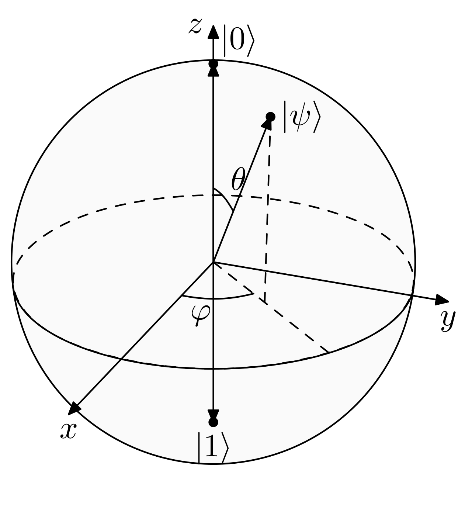
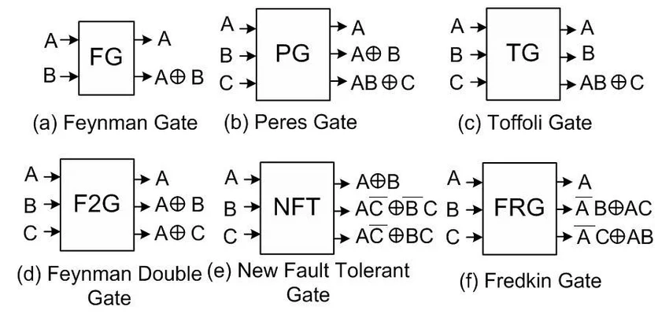
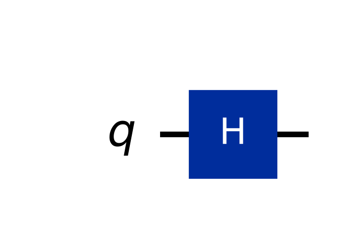
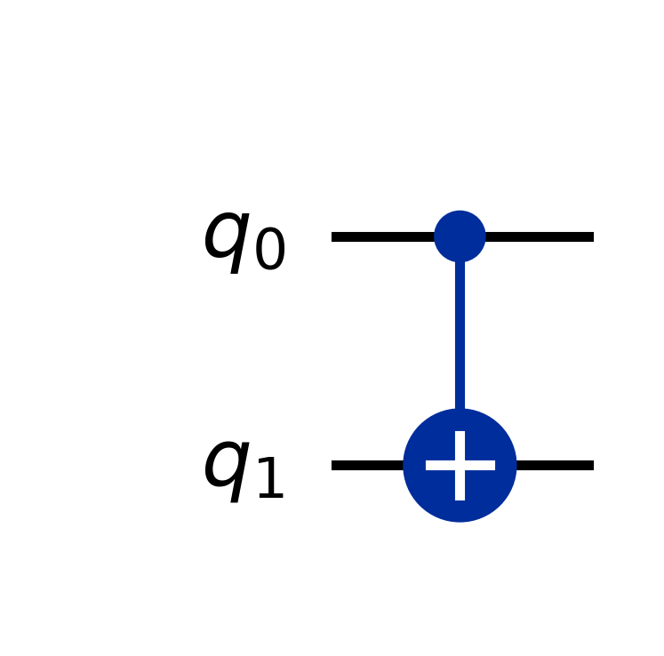

<!-- _class: cover -->
<!-- _paginate: false -->
<!-- _footer: '' -->

# Quantum<br>computing 101

## Mario Bifulco

PhD student @ University of Turin

---

# $whoami

Mario Bifulco - PhD student @ University of Turin

Research focus:

- Quantum Machine Learning
- Quantum Optimization
- Quantum High Performance Computing

---

<!-- _class: divider -->

# What is a<br>Quantum Computer?

---

# Starting question

<div class="columns visual">
<div>

~~Marvel~~ What if… we could compute with superpositions of 0 and 1?

</div>
<div>


</div>
</div>

---

# Classical vs. Quantum

<div class="columns visual image-left">
<div>


</div>
<div>

- Classical computers handle general-purpose workloads
- Quantum processors can accelerate specific problems

</div>
</div>

---

# Why does that matter?

<div class="columns visual">
<div>

- Some quantum algorithms offer large speedups over known classical methods
- Shor's algorithm could break RSA on a sufficiently large, fault-tolerant quantum computer

</div>
<div>

## Integer factorization

| Algorithm | Scaling |
| --- | --- |
| Classical* | Subexponential |
| Shor | Polynomial |

$f(\text{input bit length})$

</div>
</div>

<!-- Source: https://quantum.cloud.ibm.com/docs/en/tutorials/shors-algorithm -->
<!-- Complexity comparison: Shor, https://arxiv.org/abs/quant-ph/9508027, section 5 -->

---

# Are we F***ed?

> Quantum hardware is still at an early stage

* Hardware is noisy and difficult to scale
* Large algorithms need error correction
* Error correction requires many physical qubits per logical qubit

---

<!-- _class: divider -->

# Key concepts

---

# From RISC-V to OpenQASM

> In both cases, we write instructions for a processor

<div class="columns">
<div>

## Classical Assembly

- Memory
- Arithmetic and logic instructions
- Deterministic results

</div>
<div>

## Quantum Assembly

- Qubits
- Quantum gates
- Probabilistic measurement outcomes

</div>
</div>

---

# Classical bit

<div class="columns">
<div>

## State

$0 \quad \text{/} \quad 1$

</div>
<div>

## Read

Non-destructive

</div>
</div>
<br>

```text
bit = 0  //  I can copy it, read it and modify it
```

---

<!-- _class: compact -->

# The qubit

<div class="columns visual">
<div>

$$|\psi\rangle = \alpha|0\rangle + \beta|1\rangle$$

- $\alpha$ and $\beta$ are complex amplitudes, with $|\alpha|^2 + |\beta|^2 = 1$
- Measurement gives $0$ with probability $|\alpha|^2$ and $1$ with probability $|\beta|^2$
- In this basis, the state then becomes $|0\rangle$ or $|1\rangle$

</div>
<div>



</div>
</div>

<!-- Source: https://quantum.cloud.ibm.com/learning/en/courses/use-a-qc-today/quantum-mechanics-basics -->

---

<!-- _class: coin -->

# Qubit == Coin?

<div class="columns coin-comparison">
<div>

## Bit

Stationary coin

**Heads** or **Tails**

</div>
<div>


</div>
<div>

## Qubit

Spinning coin

**Heads** or **Tails** when measured

</div>
</div>

<p class="analogy">A useful analogy for measurement. Quantum amplitudes can also interfere.</p>

<!-- Source: https://quantum.cloud.ibm.com/learning/en/modules/quantum-mechanics/superposition-with-qiskit -->

---

# Destructive measurement

<div class="columns visual">
<div>

* Measurement probabilities depend on $|\alpha|^2$ and $|\beta|^2$
* Measurement in the 0/1 basis removes the original superposition in that basis
* Each run is a **shot**. We prepare and run the circuit again to estimate probabilities

</div>
<div>


</div>
</div>

---

# No free lunch

A quantum state can represent a superposition of many basis states, but:

- Measuring the register gives us just ONE classical bitstring per shot
- A good quantum algorithm increases the probability of a good solution
- Interference can amplify useful outcomes and suppress others

---

# Instructions

<div class="columns">
<div>

## RISC-V

```asm
addi t0, zero, 5
addi t1, zero, 7
add  t2, t0, t1
sw   t2, 0(sp)
```

</div>
<div>

## QASM

```qasm
h  q[0];
cx q[0], q[1];
measure q -> c;
```

</div>
</div>

---

# Huge difference in the instruction set

At this level, we mostly work with qubits and gates

```text
RISC-V:     add a0, a1, a2
QASM:       x, h, cx, ...
```

- Quantum gates transform the state of one or more qubits
- We often have to build higher-level operations from basic gates

---

<!-- _class: compact -->

# Reversibility

NOT is reversible: `NOT(0) = 1, NOT(1) = 0`

AND alone loses information: `AND(0, 0) = 0, AND(0, 1) = 0`

> We can't uniquely recover the inputs from the output

Quantum gates are reversible. Measurement is a separate operation.

---

<!-- _class: compact -->

# Ancilla

<div class="columns visual">
<div>

An **ancilla** is an auxiliary qubit, often initialized to $|0\rangle$.

For classical inputs, a Toffoli gate stores AND in the ancilla while preserving both inputs:

```text
(a, b, 0)
    becomes
(a, b, a AND b)
```

</div>
<div>



</div>
</div>

---

# Quantum circuit lifecycle

```text
1. Prepare qubits        |0⟩ |0⟩ |0⟩ ...
2. Apply gates           ──────────────
3. Measure               0 / 1 / 0 / ...
4. Classical post-processing
```

> Quantum software is almost always ~~Toyota~~ hybrid

---

<!-- _class: divider -->

# It's time to<br>write some code

---

<!-- _class: compact -->

# OpenQASM

<div class="columns visual">
<div>

```qasm
OPENQASM 2.0;
include "qelib1.inc";

qreg q[2];   // two qubits, initially |0>
creg c[2];   // two classical bits
```

- Low-level quantum instructions
- A program describes gates, measurements and classical control

</div>
<div>

[](https://quantum.cloud.ibm.com/composer)

</div>
</div>

---

<!-- _class: gate -->

# X gate: quantum NOT

<div class="columns">
<div>

```qasm
x q[0];
```

$$|0\rangle \leftrightarrow |1\rangle$$

</div>
<div>


</div>
</div>

---

<!-- _class: gate -->

# H gate: superposition

<div class="columns">
<div>

```qasm
h q[0];
```

Starting from $|0\rangle$:

$$H|0\rangle = \frac{|0\rangle + |1\rangle}{\sqrt{2}}$$

Measurement gives 0 or 1 with equal probability.

</div>
<div>



</div>
</div>

<!-- Source: https://quantum.cloud.ibm.com/learning/en/courses/use-a-qc-today/quantum-mechanics-basics -->

---

<!-- _class: gate -->

# CNOT gate: two-qubit gate

<div class="columns">
<div>

```qasm
cx q[0], q[1];
```

For basis states:

```python
if control == 1:
    target = not target
```

It acts coherently on superpositions.

</div>
<div>



</div>
</div>

<!-- Source: https://quantum.cloud.ibm.com/learning/en/courses/use-a-qc-today/quantum-mechanics-basics -->

---

<!-- _class: compact -->

# H + CX: entanglement

Starting from $|00\rangle$:

```qasm
h  q[0];
cx q[0], q[1];
```

$$|\psi\rangle = \frac{|00\rangle + |11\rangle}{\sqrt{2}}$$

In an ideal circuit, measurement gives **00** or **11**, each with probability 50%. Hardware noise can introduce other outcomes.

<!-- Source: https://quantum.cloud.ibm.com/learning/en/courses/use-a-qc-today/quantum-mechanics-basics -->

---

# Entanglement (pt. 2)

Starting again from $|00\rangle$:

```qasm
x q[1];
h q[0];
cx q[0], q[1];
```

What outcomes can we get from this circuit?

* Answer: **01** or **10**, each with probability 50% in an ideal circuit

---

<!-- _class: divider -->

# Exercises

---

<!-- _class: compact -->

# True random number generator

<div class="columns">
<div>

```qasm
OPENQASM 2.0;
include "qelib1.inc";

qreg q[1];
creg c[1];
h q[0];
measure q -> c;
```

</div>
<div>

Classical software often uses [pseudorandom generators](https://www.cloudflare.com/learning/ssl/lava-lamp-encryption/). Measurement provides quantum randomness.

In an ideal circuit, each shot gives 0 or 1 with probability 50%.

[Try it in IBM Quantum Composer](https://quantum.cloud.ibm.com/composer)

</div>
</div>

<!-- Source: https://quantum.cloud.ibm.com/learning/en/courses/use-a-qc-today/quantum-mechanics-basics -->

---

<!-- _class: compact -->

# It's your time to shine

<div class="columns visual">
<div>

Write a quantum circuit that generates **different 4-bit strings**, each with exactly two 1s and two 0s.

Valid bitstrings:

```text
0011   0101   0110
1100   1010   1001
```

</div>
<div>

[](https://quantum.cloud.ibm.com/composer)

</div>
</div>

---

<!-- _class: compact solution -->

# Possible solution

<div class="columns">
<div>

```qasm
OPENQASM 2.0;
include "qelib1.inc";

qreg q[4];
creg c[4];
h q[0];
x q[1];
cx q[0], q[1];

h q[2];
x q[3];
cx q[2], q[3];
measure q -> c;
```

</div>
<div>

Each pair produces **01** or **10**, so every result has two 1s and two 0s.

This circuit produces:

```text
0101   0110
1001   1010
```

Each has probability 25% in an ideal circuit. This solution covers four of the six valid bitstrings.

</div>
</div>

---

# Takeaways

1. A QPU works alongside classical processors as an accelerator for specific problems
2. OpenQASM is a low-level language for describing quantum programs/circuits
3. We use gates to transform quantum states, then we obtain classical outcomes through measurement

---

<!-- _class: closing -->
<!-- _paginate: false -->
<!-- _footer: '' -->

<div class="columns visual">
<div>

# Thanks

Slides

[mariobifulco.github.io/QASMSeminar](https://mariobifulco.github.io/QASMSeminar/)

Source & examples

[github.com/mariobifulco/QASMSeminar](https://github.com/mariobifulco/QASMSeminar)

</div>
<div>

[](https://mariobifulco.github.io/QASMSeminar/)

</div>
</div>
